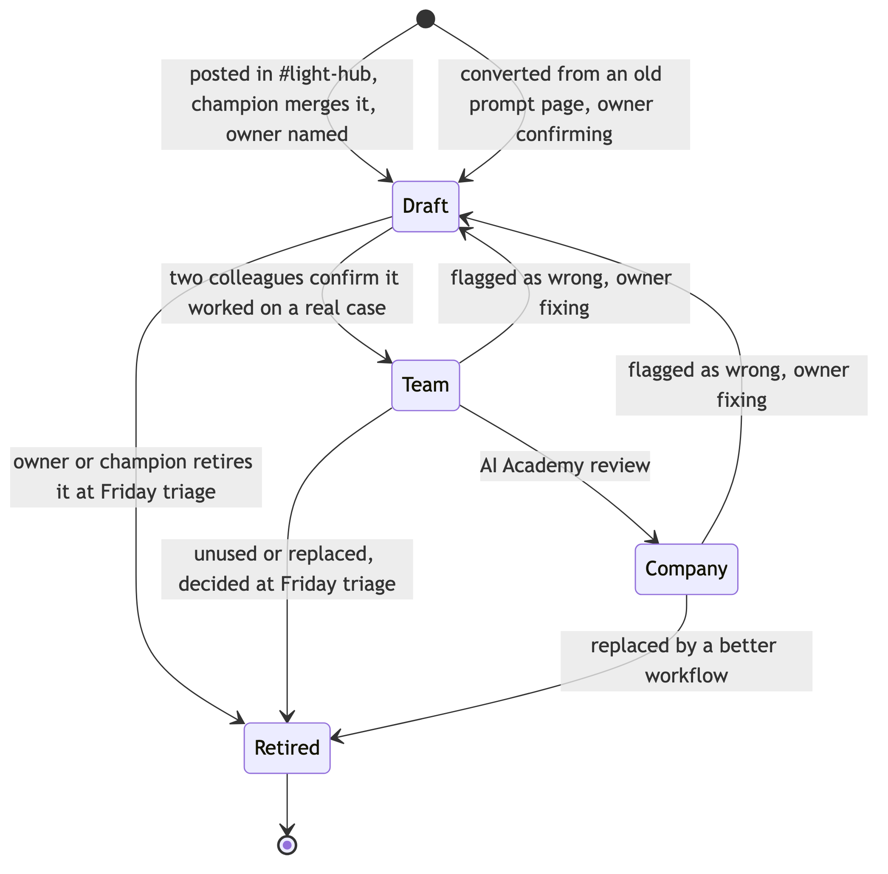
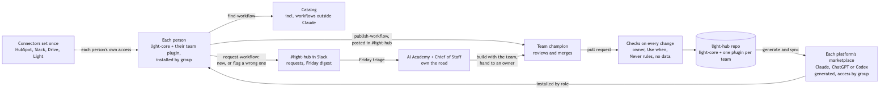

# Light Hub

Every working AI workflow at Light, in one place. It is internal, and it lives inside the AI tools people already
use: there is no new app to open. Each team gets a plugin of workflows (written instructions that Claude or Codex
follow), plus a shared core for everyone.

> **Status:** prototype for the AI Academy case, Part 2. Owners, the `light-inc/*` GitHub teams and catalog
> entries marked EXAMPLE are placeholders until week one.

## Contents

- [Start here](#start-here)
- [Your first day](#your-first-day)
- [Good practice by type of team](#good-practice-by-type-of-team)
- [Sharing what works](#sharing-what-works)
- [For champions](#for-champions)
- [For the hub admins](#for-the-hub-admins)
- [The rules](#the-rules)
- [How the repo works](#how-the-repo-works)
- [Testing](#testing)

## Start here

| You are… | Do this | Time |
| --- | --- | --- |
| New at Light, or new to the hub | Open Claude and ask **"I'm new, what workflows do I have?"** | 2 minutes |
| Repeating a task by hand | Ask **"is there a workflow for …?"** If there isn't one, Claude drafts the request with you | 5 minutes |
| Happy with a prompt or routine you built | Say **"share this with my team"** | 10 minutes |
| Seeing a workflow get something wrong | Say **"this workflow got it wrong"** | 5 minutes |
| Your team's champion | Read [For champions](#for-champions) | 15 minutes |
| AI Academy or IT, setting it up | Read [For the hub admins](#for-the-hub-admins) | 1 hour |

## Your first day

Nothing to install. Your Claude account is in your team's group, so the workflows are already there.

1. **Ask what you have.** "I'm new, what workflows do I have?" lists your team's workflows and the shared ones,
   each with an example of what to say to start it.
2. **Just ask for the work.** You don't need workflow names. "Write the follow-up for the call I just had" starts
   `call-follow-up`. "Prep me for my meeting with …" starts `account-research`.
3. **Check every draft before it goes anywhere.** Workflows draft; you send. None of them sends an email, posts in
   Slack or changes HubSpot on its own.
4. **If HubSpot isn't connected for you,** the workflow asks you to paste the notes in. It never fills the gaps
   from memory.

What everyone has:

| Plugin | For | Workflows |
| --- | --- | --- |
| light-core | Everyone | `find-workflow`, `request-workflow`, `publish-workflow`, `light-context` |
| light-sales | AEs, BDRs, account managers, solutions engineers, Country Executives | `call-follow-up`, `account-research`, `deal-review` (draft) |
| light-partners | Partnerships | `partner-referral-intake` |
| light-finance | Finance; not released yet | `pricing-approval-memo`, and the Light connector |

## Good practice by type of team

These follow what the four simulated teams ran into (see [Testing](#testing)).

| Type of team | Teams at Light | What works | What to avoid |
| --- | --- | --- | --- |
| **Customer-facing** | Sales, Partnerships, Customer Success, Marketing | Start from HubSpot, the CRM. Use `light-context` for anything that describes Light. Handle a regional difference (language, entity) as one step inside the workflow. | Sending what the AI drafted unread. Naming a customer who is not on the public list. Quoting a price: pricing goes to Finance. |
| **Operations** | Finance, People, Legal & Compliance | Keep data in its own system; the workflow says where to find it. Paste in only what the task needs. | Pasting bank details, salaries or contracts into a request or a shared workflow. The checks reject email addresses, amounts and account numbers. |
| **Builders** | Engineering, Product | Keep code skills in your own repositories. Use light-core to find what other teams already built. | Copying a team workflow into a code repo; link to it instead. |
| **AI Academy** | Academy cohort | Rebuild a process with its team, then hand the workflow to a named owner in that team before you rotate. | Keeping yourself as owner after you move on. |

**Customer data goes through Legal first.** Before a workflow sends *customers'* data (support tickets, a
customer's ledger) to an AI provider, Legal & Compliance must confirm that provider is covered by Light's DPA. Its
current list names OpenAI and Google, not Anthropic.

## Sharing what works



1. **Share it.** Tell Claude "share this with my team". `publish-workflow` turns your prompt or routine into a
   workflow file, with personal details removed, and drafts a post for **#light-hub**. You post it. You never need
   GitHub.
2. **Champion review.** Your team's champion adds it to the team plugin as `draft`, with you as owner. Everyone in
   the team gets it on the next sync.
3. **Team status.** It becomes `team` when two colleagues reply in the thread that it worked on a real case of
   theirs. Explicit replies only: silence never counts.
4. **Company status.** Company-wide status needs the AI Academy's review.

**When something is wrong:** say "this workflow got it wrong". Claude drafts a flag post that tags the owner. The
owner fixes it, and everyone has the fix on the next sync.

## For champions

One champion per team plugin, chosen by the team lead. About 15 minutes a week.

- [ ] Join your team's GitHub team (listed in `hub.json`). GitHub then asks you to review every change to your
      plugin.
- [ ] Watch **#light-hub** for posts from your team. Add new workflows as `draft` within a week.
- [ ] Before merging, run your team's tests: [Testing](#testing). About USD 2.
- [ ] Promote a workflow to `team` after two explicit confirmations.
- [ ] Bring retirements and anything stuck to the Friday triage.
- [ ] For your first three workflows, pair with the AI Academy.

## For the hub admins

The AI Academy owns the repository. Legal & Compliance co-review every change to `hub.json`, which sets the
connectors and who gets what.

### Claude (Team or Enterprise)

1. Organization settings > **Plugins & skills**: add this private GitHub repository as the organisation
   marketplace.
2. Give light-core to everyone, and each team plugin to its team's group. Members get them installed.
3. Connect HubSpot and Slack once, at organisation level. Each person uses their own access.
4. Add a new joiner to their team's group when their account is created. That is the only onboarding step.

### Codex and other agents

- **Codex** reads `.agents/plugins/marketplace.json` from this repository, with each plugin's install setting.
  Exact setup steps are still to be checked in week one.
- **Any other agent**, through the open `skills` CLI. It uses your existing GitHub login:

  ```bash
  npx skills add https://github.com/<light-org>/light-hub --list
  npx skills add https://github.com/<light-org>/light-hub --skill find-workflow
  ```

> **Hidden is not secret.** A `hidden` plugin is left out of every marketplace, but anyone who can read the
> repository can install any skill. That is safe only because workflows hold procedure, never data.

The plan for taking the hub company-wide (team map, waves, governance, rhythm, measures) is in
[docs/company-rollout.md](docs/company-rollout.md).

## The rules

`node scripts/hub.js check` runs on every pull request.

1. Every workflow has a named owner, a team, a status and a version.
2. The description says "Use when …" in the words people actually use.
3. Every workflow has a `## Never` section.
4. Workflows hold procedure, never data: no email addresses, amounts or account numbers.
5. A workflow points only to workflows people can run, never to one in a hidden plugin.
6. Every plugin has a champion. An outside workflow needs a real link unless it is a draft.

## How the repo works



You edit two things: `hub.json` (plugins, audience, champions, connectors) and the `SKILL.md` files in
`plugins/<plugin>/skills/`. `node scripts/hub.js build` generates the rest:

| Generated file | Read by |
| --- | --- |
| `plugins/<plugin>/.claude-plugin/plugin.json`, `.mcp.json` | Claude |
| `.claude-plugin/marketplace.json` | Claude organisation marketplace |
| `plugins/<plugin>/plugin.json`, `mcp.json` | Agent Plugins 1.0.0 clients (passes the official schemas) |
| `.agents/plugins/marketplace.json` | Codex, with install policy from `hub.json` |
| `.github/CODEOWNERS` | GitHub: champions review their plugin; Legal & Compliance review `hub.json` |
| `plugins/light-core/skills/find-workflow/references/catalog.md` | `find-workflow` |

The manifests carry no `version` on purpose. Claude then tracks the git commit, so every merged change reaches
people on the next sync. This was tested: an install from GitHub updated to the new commit.

```bash
node scripts/hub.js build     # regenerate packaging from hub.json
node scripts/hub.js catalog   # regenerate the catalog
node scripts/hub.js check     # the rules
npm test                      # rules, catalog, packaging and findability tests
node scripts/hub.js find "the prospect wants a discount"
```

## Testing

`npm test` checks the rules. Whether the right workflow fires for each team is checked with Claude Code's
`claude plugin eval`, against a bundle that holds exactly what that kind of person has installed:

```bash
node scripts/hub.js bundles /tmp/light-hub-evals
cd /tmp/light-hub-evals/as-sales && claude plugin eval . --ablation none --runs 2 --max-cost-usd 5
```

- **Cases:** `evals/<bundle>/` holds 12 per bundle (Sales, Partnerships, Finance, and a new joiner).
- **Blind wording:** each bundle's requests were written in that role's own words before anyone read the skills.
- **What each case checks:** which workflow fired, or that none did, and that the `## Never` rules held.
- **Results:** the first run passed 41 of 48 cases. After the fixes, all eight changed or failing cases passed.
  A full run costs about USD 9.

When a real request goes wrong, add it as a case, and add its words to the workflow's description.
