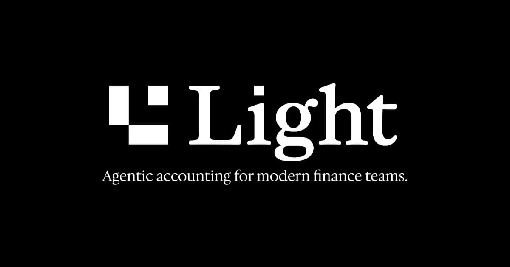
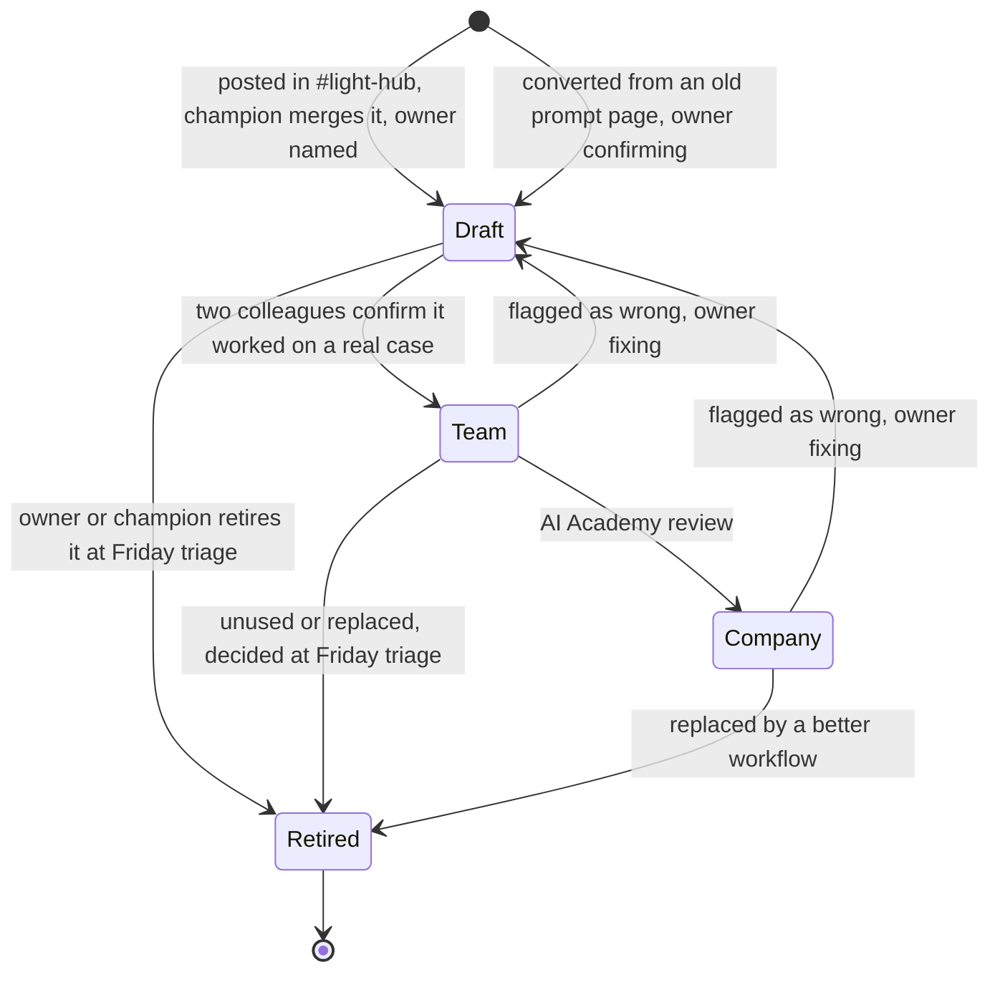
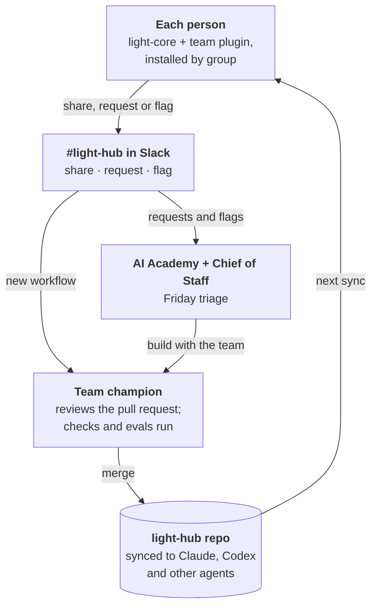

# Light Hub

Every working AI workflow at Light, in one place. It is internal, and it lives inside the AI tools people already
use: there is no new app to open. Each team gets a plugin of workflows (written instructions that Claude or Codex
follow), plus a shared core for everyone.

## Contents

- [Start here](#start-here)
- [Your first day](#your-first-day)
- [Good practice by type of team](#good-practice-by-type-of-team)
- [Sharing what works](#sharing-what-works)
- [For champions](#for-champions)
- [For the hub admins](#for-the-hub-admins)
- [The rules](#the-rules)
- [How the repo works](#how-the-repo-works)
- [Testing](#testing)

## Start here

| You are… | Do this | Time |
| --- | --- | --- |
| New at Light, or new to the hub | Open Claude and ask **"I'm new, what workflows do I have?"** | 2 minutes |
| Repeating a task by hand | Ask **"is there a workflow for …?"** If there isn't one, Claude drafts the request with you | 5 minutes |
| Happy with a prompt or routine you built | Say **"share this with my team"** | 10 minutes |
| Seeing a workflow get something wrong | Say **"this workflow got it wrong"** | 5 minutes |
| Your team's champion | Read [For champions](#for-champions) | 15 minutes |
| AI Academy or IT, setting it up | Read [For the hub admins](#for-the-hub-admins) | 1 hour |

## Your first day

Nothing to install. Your Claude account is in your team's group, so the workflows are already there.

1. **Ask what you have.** "I'm new, what workflows do I have?" lists your team's workflows and the shared ones,
   each with an example of what to say to start it.
2. **Just ask for the work.** You don't need workflow names. "Write the follow-up for the call I just had" starts
   `call-follow-up`. "Prep me for my meeting with …" starts `account-research`.
3. **Check every draft before it goes anywhere.** Workflows draft; you send. None of them sends an email, posts in
   Slack or changes HubSpot on its own.
4. **If HubSpot isn't connected for you,** the workflow asks you to paste the notes in. It never fills the gaps
   from memory.

What everyone has:

| Plugin | For | Workflows |
| --- | --- | --- |
| light-core | Everyone | `find-workflow`, `request-workflow`, `publish-workflow`, `light-context` |
| light-sales | AEs, BDRs, account managers, solutions engineers, Country Executives | `call-follow-up`, `account-research`, `deal-review` (draft), `rfp-answers` (draft) |
| light-partners | Partnerships | `partner-referral-intake` |
| light-customer-success | Implementation, data migration, agentic customer engineers, support | `go-live-check` (draft), `help-article-update` (draft) |
| light-marketing | Product, growth and regional marketing | `localise-content` (draft) |
| light-people | Talent Partners and hiring managers | `hiring-scorecard` (draft) |
| light-finance | Finance; not released yet | `pricing-approval-memo`, and the Light connector |

## Good practice by type of team

These come from what each team's eval cases test (see [Testing](#testing)).

| Type of team | Teams at Light | What works | What to avoid |
| --- | --- | --- | --- |
| **Customer-facing** | Sales, Partnerships, Customer Success, Marketing | Start from HubSpot, the CRM. Use `light-context` for anything that describes Light. Handle a regional difference (language, entity) as one step inside the workflow. | Sending what the AI drafted unread. Naming a customer who is not on the public list. Quoting a price: pricing goes to Finance. |
| **Operations** | Finance, People, Legal & Compliance | Keep data in its own system; the workflow says where to find it. Paste in only what the task needs. | Pasting bank details, salaries or contracts into a request or a shared workflow. The checks reject email addresses, amounts and account numbers. |
| **Builders** | Engineering, Product | Keep code skills in your own repositories. Use light-core to find what other teams already built. | Copying a team workflow into a code repo; link to it instead. |
| **AI Academy** | Academy cohort | Rebuild a process with its team, then hand the workflow to a named owner in that team before you rotate. | Keeping yourself as owner after you move on. |

**Customer data goes through Legal first.** Before a workflow sends *customers'* data (support tickets, a
customer's ledger) to an AI provider, Legal & Compliance must confirm that provider is covered by Light's DPA. Its
current list names OpenAI and Google, not Anthropic.

## Sharing what works

How a workflow travels from draft to company-wide:



1. **Share it.** Tell Claude "share this with my team". `publish-workflow` turns your prompt or routine into a
   workflow file, with personal details removed, and drafts a post for **#light-hub**. You post it. You never need
   GitHub.
2. **Champion review.** Your team's champion adds it to the team plugin as `draft`, with you as owner. Everyone in
   the team gets it on the next sync.
3. **Team status.** It becomes `team` when two colleagues reply in the thread that it worked on a real case of
   theirs. Explicit replies only: silence never counts.
4. **Company status.** Company-wide status needs the AI Academy's review.

**When something is wrong:** say "this workflow got it wrong". Claude drafts a flag post that tags the owner. The
owner fixes it, and everyone has the fix on the next sync.

## For champions

One champion per team plugin, chosen by the team lead. About 15 minutes a week.

- [ ] Join your team's GitHub team (listed in `hub.json`). GitHub then asks you to review every change to your
      plugin.
- [ ] Watch **#light-hub** for posts from your team. Add new workflows as `draft` within a week.
- [ ] Before merging, run your team's tests: [Testing](#testing). About USD 2.
- [ ] Promote a workflow to `team` after two explicit confirmations.
- [ ] Bring retirements and anything stuck to the Friday triage.
- [ ] For your first three workflows, pair with the AI Academy.

## For the hub admins

The AI Academy owns the repository. Legal & Compliance co-review every change to `hub.json`, which sets the
connectors and who gets what.

Light's confirmed AI tools are Claude, Codex, Lovable and Noon (job posts). Each was checked against its own
documentation, and tested where a command-line tool exists:

| Tool | What people get | Tested |
| --- | --- | --- |
| **Claude**: web, desktop, mobile, Cowork, Claude Code | every workflow and connector | validator (`--strict`) passes; install and update from GitHub |
| **Codex** (and ChatGPT, through the same workspace plugins) | every workflow, Finance's connector | Codex CLI 0.171.0: marketplace added, plugins installed, Finance refused, skills in the prompt |
| **Lovable** | the workflows while building apps; `light-context` as workspace instructions | from its docs |
| **Noon** (recruiting agent, synced with Ashby) | nothing to install: Claude reaches it as a connector | from its docs |

### Claude

1. Organization settings > **Plugins & skills**:
   - Turn on **Skills** and **Cloud code execution and file creation**.
   - Add this private GitHub repository as the organisation marketplace.
2. Choose who gets what:
   - **Enterprise:** in Organization settings > Groups, set light-core to *Installed by default* for everyone,
     and each team plugin to *Installed by default* for its team's group.
   - **Team plan:** there are no per-group settings, so *Installed by default* means everyone. Set light-core to
     *Installed by default*, and team plugins to *Available to install*. A new joiner installs their team's
     plugin once.
3. Organization settings > **Connectors**: add HubSpot and Slack once; each person signs in with their own
   account. The Light connector (`https://api.light.inc/rest/ext/mcp`) is added the same way when Finance releases its
   plugin. It must be reachable from the internet and sign in with OAuth.
4. **New joiners:** add them to their team's group when their account is created. That is the only onboarding
   step.

Versions bump themselves: `node scripts/hub.js build` raises a plugin's version whenever its content changes.
Organisation sync and Codex both look for a version change. If a sync ever looks stuck, an Owner can press
**Re-sync**.

### Codex and ChatGPT

**Admin, once (Business or Enterprise workspace):**
1. Admin console > Plugins > Add > **Import marketplace**, and point it at this repository. It syncs daily.
2. Set light-core and the team plugins to **Installed**. Enterprise can do this per role.
3. **Switch off light-finance by hand.** The import does not apply the repository's install settings.

**One person, from the Codex CLI** (verified; it uses their GitHub login):

```bash
codex plugin marketplace add <light-org>/light-hub
codex plugin add light-core@light-hub
codex plugin add light-sales@light-hub        # or your team's plugin
codex plugin marketplace upgrade light-hub    # get updates
```

In Codex, start a workflow with `$`, for example `$call-follow-up`, or just describe the task. In ChatGPT, use
`@`.

### Lovable

Lovable is for building internal apps. Its assistant chat ("Chats") cannot load workflows, so the hub helps
while building:
1. **Workspace instructions:** paste `plugins/light-core/skills/light-context/SKILL.md`, without the CONFIRM
   lines, into the workspace instructions. It is well under the 10,000-character limit.
2. **Skills:** a workspace owner imports a skill as a ZIP, because the repository is private:

   ```bash
   cd plugins/light-core/skills && zip -r light-context.zip light-context
   ```

3. **Catalog:** list each Lovable app people should use in `catalog/outside-claude.json`, with
   `"runs_in": "Lovable app"` and its link, so `find-workflow` can point to it.

### Noon

Noon runs its own recruiting agent and cannot load workflows. Two things connect it to the hub:
- **Claude can call Noon:** each recruiter adds it as a custom connector, using the URL from Noon's
  Settings > MCP.
- **The catalog lists it** (`candidate-sourcing`). It is hidden until the Talent champion adds Light's Noon link.

### Any other agent

The open `skills` CLI installs the workflows into other agents, using your GitHub login:

```bash
npx skills add https://github.com/<light-org>/light-hub --list
npx skills add https://github.com/<light-org>/light-hub --skill find-workflow
```

> **Hidden is not secret.** A `hidden` plugin is left out of every marketplace, but anyone who can read the
> repository can install any skill. That is safe only because workflows hold procedure, never data.

The plan for taking the hub company-wide (team map, waves, governance, rhythm, measures) is in
[docs/company-rollout.md](docs/company-rollout.md).

## The rules

`node scripts/hub.js check` runs on every pull request.

1. Every workflow has a named owner, a team, a status and a version.
2. The description says "Use when …" in the words people actually use.
3. Every workflow has a `## Never` section.
4. Workflows hold procedure, never data: no email addresses, amounts or account numbers.
5. A workflow points only to workflows people can run, never to one in a hidden plugin.
6. Every plugin has a champion. An outside workflow needs a real link unless it is a draft.

## How the repo works

From one person's routine to every team's AI tool:



You edit two things: `hub.json` (plugins, audience, champions, connectors) and the `SKILL.md` files in
`plugins/<plugin>/skills/`. `node scripts/hub.js build` generates the rest:

| Generated file | Read by |
| --- | --- |
| `plugins/<plugin>/.claude-plugin/plugin.json`, `.mcp.json` | Claude |
| `.claude-plugin/marketplace.json` | Claude organisation marketplace |
| `plugins/<plugin>/plugin.json`, `mcp.json` | Agent Plugins 1.0.0 clients (passes the official schemas) |
| `.agents/plugins/marketplace.json` | Codex, with install policy from `hub.json` |
| `.github/CODEOWNERS` | GitHub: champions review their plugin; Legal & Compliance review `hub.json` |
| `plugins/light-core/skills/find-workflow/references/catalog.md` | `find-workflow` |
| `hub.lock.json` | `build`: the content hash and version of each plugin |

Nobody edits a version. `hub.lock.json` keeps a hash of each plugin's content, and `build` raises the patch
version whenever that hash changes, so every merged change is a new version on every platform.

```bash
node scripts/hub.js build     # regenerate packaging from hub.json
node scripts/hub.js catalog   # regenerate the catalog
node scripts/hub.js check     # the rules
npm test                      # rules, catalog, packaging and findability tests
node scripts/hub.js find "the prospect wants a discount"
```

## Testing

`npm test` checks the rules. Whether the right workflow fires for each team is checked with Claude Code's
`claude plugin eval`, against a bundle that holds exactly what that kind of person has installed.

**Once set up, nothing reaches `main` until its evals pass.**

| When | What runs | Set up |
| --- | --- | --- |
| Every `git push` | hub rules, `npm test`, then the evals for what changed | once per clone: `npm run hooks` |
| Every pull request that touches `plugins/`, `evals/` or `hub.json` | the same evals in GitHub Actions | `ANTHROPIC_API_KEY` repository secret; make `evals` a required check on `main` |
| Monthly | every bundle | `npm run evals:all` (about USD 9) |

- **Only what changed runs.** A team plugin or its eval folder runs that team's bundle. light-core and
  `hub.json` reach everyone, so they run every bundle. README and docs changes run nothing.
- **Pass mark:** each case runs 3 times and must score at least 0.66, so roughly 2 of 3 runs hold up. One noisy
  judge vote doesn't block a push; a workflow that is wrong most of the time does. Set `EVAL_THRESHOLD` to change it.
- **Cost cap:** at most USD 5 per bundle per run (`EVAL_MAX_COST_USD`). A typical change to one team costs USD 1–3.
- **Run it yourself first:** `npm run evals`. The HTML report for each bundle is printed at the end.
- **Skip once:** `git push --no-verify`. The pull-request check still runs.
- **When a case fails,** read the report. Fix the workflow, or fix the grader if the reply was right and the
  grader too strict. Never lower the pass mark to get a push through.

**Cases:** `evals/<bundle>/` holds one folder per case, for 7 bundles: a new joiner, Sales, Partnerships,
Customer Success, Marketing, People and Finance. Each bundle's requests were written in that role's own words
before anyone read the skills. Each case checks which workflow fired, or that none did, and that the
`## Never` rules held.

When a real request goes wrong, add it as a case, and add its words to the workflow's description.
